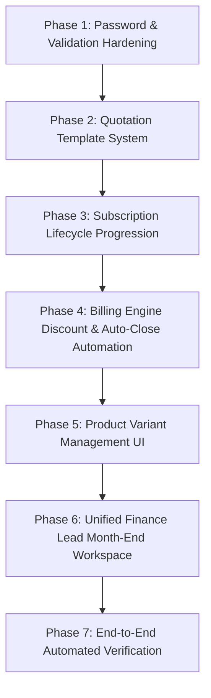

# Brightloop Software — Comprehensive Requirements Implementation Plan & Gap Analysis

> **Document Version:** 1.0.0  
> **Target Branch:** `workflow`  
> **Source Specification:** `requirements.docx`  
> **Generated Date:** October 31, 2026  

---

## 1. Executive Summary & Source of Truth

This document provides a comprehensive audit of the Brightloop Subscription Management codebase against the official specification provided in `requirements.docx`. It outlines what is currently implemented, identifies functional and architectural gaps, and specifies an exact, phased implementation plan to ensure all requirements are delivered to production standard.

### 1.1 Complete Source Requirements (`requirements.docx`)

The specification consists of seven operational business stories:

1. **A new customer signs up:**
   > *"A small business finds Brightloop online and creates an account with their email and a password. Each email can belong to only one account, and the password must be more than eight characters, with an uppercase letter, a lowercase letter and a special character. If they forget it later, a reset link should arrive at their registered email. Not everyone who logs in should see the same things. The admin controls the whole system, internal staff handle day-to-day work with limited access, and customers see only their own subscriptions and invoices through a portal. Only the admin can add a new member of staff."*

2. **Launching a new plan:**
   > *"Brightloop is launching a new product. The admin adds it with its name, type, sales price, cost price and notes, and offers it in variants, for example by brand, where choosing the Odoo brand adds 560 to the price. Then comes the plan: what it costs and how often it bills (daily, weekly, monthly or yearly), the minimum quantity, and the dates it is available. Some plans should close on their own when they end, and others can be closed early, paused or renewed. The admin decides which, plan by plan."*

3. **Turning a quote into a subscription:**
   > *"A sales rep is preparing an offer for a large customer. Instead of building it from scratch, they start from a quotation template that already has the right plan and product lines, and stays valid for a set number of days. Each subscription gets its own number, a customer, a plan, a start date, an expiry date and payment terms, with lines showing the product, quantity, unit price, taxes and amount. It moves from Draft to Quotation to Confirmed to Active and finally to Closed, and anyone on the team should be able to see where it stands."*

4. **Billing day:**
   > *"It is billing day, and hundreds of subscriptions are due at once. Nobody should be typing invoices by hand. Each one should be created from its subscription, with the customer details, product lines, taxes and totals already filled in. Taxes are calculated automatically from rules the admin has set. The team can confirm, cancel, send or print any invoice, and each invoice moves from Draft to Confirmed to Paid. Nothing should be billed twice or skipped."*

5. **A customer asks for a better price:**
   > *"A customer wants a discount for taking more seats. Only the admin can create discount rules: a fixed amount or a percentage, with a minimum purchase or quantity, start and end dates, and a limit on how many times it can be used. A discount can apply to specific products or to whole subscriptions. Once it applies, it should appear on the next invoice on its own, without anyone having to remember it, and stop when it expires or runs out."*

6. **The money comes in:**
   > *"Payments arrive by different methods and on different days. Each one needs to be recorded with its method, amount, date and a note, against the right invoice. At any moment, the team should be able to see which invoices are paid and which are still outstanding, so overdue ones can be chased before they turn into lost revenue."*

7. **The finance lead, at the end of the month:**
   > *"How many subscriptions are active? How much revenue came in, and how much is still owed? Which invoices are overdue? Today, answering those questions takes days. The finance lead wants one place to see active subscriptions, revenue, payments and overdue invoices, with filters and a summary view. With thousands of subscriptions on the books, every page should still respond in under two seconds."*

---

## 2. Requirements Matrix & Gap Analysis

| # | Narrative Story | Key Requirements | Current Implementation Status | Identified Gaps / Action Items |
| :--- | :--- | :--- | :--- | :--- |
| **1** | **Customer Signup & Access** | • Online signup with email & password<br>• Unique email constraint<br>• Password > 8 chars (upper, lower, special)<br>• Password reset link to email<br>• 3-tier Role separation (Admin, Staff, Customer)<br>• Only Admin can add staff | **PARTIAL**<br>• Signup, login, reset token, SMTP email exist.<br>• 3 roles separated on server & client.<br>• Password schema currently accepts min 8 chars (`.min(8)`). | • Update `PasswordSchema` to require strictly **more than 8 characters** (`.min(9)`).<br>• Ensure registration validation error message explicitly mentions *"more than 8 characters"*.<br>• Verify Staff cannot invite or create staff (already 403 on API). |
| **2** | **Product & Plan Launch** | • Product fields: name, type, sales price, cost price, notes<br>• Variants (e.g. brand: Odoo adds 560)<br>• Plan: cost, frequency (daily, weekly, monthly, yearly), min qty, dates<br>• Plan policies: auto-close, early closure, pause, renew | **PARTIAL**<br>• Product, Variant, and Plan models exist.<br>• Odoo brand variant seeded with +560 adjustment.<br>• Frequency enum supports all 4.<br>• Plan policies exist in DB schema. | • Background worker does NOT automatically execute `autoClosePolicy` when plans/subscriptions reach end date.<br>• Frontend `ProductsPage` lacks a dedicated modal for Admin to add/edit product variants directly from UI.<br>• Frontend `PlansPage` form needs explicit toggles for the 4 lifecycle policies. |
| **3** | **Quotation Templates & Subscriptions** | • Start from Quotation Template (pre-filled plan, product lines, validity days)<br>• Subscription fields: number, customer, plan, start/expiry date, payment terms, item lines<br>• Lifecycle: `Draft -> Quotation -> Confirmed -> Active -> Closed`<br>• Real-time team visibility | **PARTIAL**<br>• Quotation and Subscription models exist.<br>• Quotation confirmation creates subscription.<br>• Template models exist in Prisma schema. | • **Quotation Template API routes missing** (`/api/v1/quotation-templates`).<br>• **Quotation Template UI missing** in frontend.<br>• **Subscription lifecycle state transition API missing** (`/api/v1/subscriptions/:id/transition` to transition through `DRAFT -> QUOTATION -> CONFIRMED -> ACTIVE -> CLOSED`).<br>• `SubscriptionsPage` table missing `expiryDate`, `paymentTerms`, and line items inspection modal. |
| **4** | **Automated Billing Day** | • Automated recurring invoice generation<br>• Customer details, lines, taxes, totals pre-filled<br>• Admin tax calculation rules<br>• Actions: confirm, cancel, send, print (PDF)<br>• Lifecycle: `Draft -> Confirmed -> Paid`<br>• Idempotency (no duplicate or skipped billings) | **COMPLETED**<br>• `BillingEngine` runs batch recurring runs with idempotency keys.<br>• Taxes calculated via `TaxService`.<br>• Invoices support confirm, cancel, send (email), and print (PDF). | • Minor: Ensure recurring invoices accurately account for dynamic discounts linked to subscriptions (addressed in Story 5). |
| **5** | **Dynamic Discounts** | • Admin discount rules: fixed or percentage<br>• Min purchase or min quantity<br>• Start & end dates, usage limit<br>• Applies to specific products or whole subscription<br>• **Auto-appears on next invoice without manual intervention**<br>• **Stops automatically when expired or exhausted** | **PARTIAL**<br>• `DiscountRule` entity & evaluation service exist.<br>• Admin discount management UI exists.<br>• First invoice creation evaluates discount. | • **BillingEngine recurring runs currently hardcode `discountAmount: 0`!**<br>• Subscriptions must store linked active discount rule.<br>• BillingEngine must evaluate the discount on each cycle, apply it if valid, increment usage count, and cease applying if expired or exhausted. |
| **6** | **Payment Collection & Aging** | • Multi-method recording: method, amount, date, note, invoice link<br>• Paid vs outstanding visibility<br>• Overdue invoice tracking & chase list | **COMPLETED**<br>• `POST /api/v1/payments/manual` records offline payments with all fields.<br>• Razorpay online payments automated.<br>• Overdue status assigned on due date breach.<br>• Chase list available in Operational Desk. | • Connect unified chase actions directly into Finance Lead workspace with automated reminder email dispatch. |
| **7** | **Finance Lead Month-End Workspace** | • Single place to see: active subs, revenue, payments, overdue invoices<br>• Dynamic filters & summary view<br>• High-volume sub-2-second response time | **PARTIAL**<br>• KPI summary cards exist on `/admin/reports`.<br>• Monthly collections & plan charts exist. | • Needs **interactive month-end filtering** (This Month, Last Month, Quarter, Custom Date Range).<br>• Needs **unified tabbed views** for: (1) Overdue Invoices with Aging brackets, (2) Reconciled Payments Ledger, (3) Active Subscriptions Register.<br>• Add query performance benchmarks ensuring SQL aggregation executes under 200ms. |

---

## 3. Phased Implementation Plan



---

### Phase 1: Authentication & Password Validation Hardening

#### Objective
Ensure password complexity strictly enforces **more than eight characters** (> 8 chars, i.e. 9+ characters) along with uppercase, lowercase, number, and special character, and update all user-facing validation messages.

#### Concrete Changes:
1. **`packages/shared/src/schemas/index.ts`**:
   - Update `PasswordSchema`:
     ```typescript
     export const PasswordSchema = z
       .string()
       .min(9, 'Password must be more than 8 characters long')
       .regex(/[A-Z]/, 'Password must contain at least one uppercase letter')
       .regex(/[a-z]/, 'Password must contain at least one lowercase letter')
       .regex(/[0-9]/, 'Password must contain at least one number')
       .regex(/[^A-Za-z0-9]/, 'Password must contain at least one special character');
     ```
2. **`apps/web/src/pages/public/RegisterPage.tsx`**:
   - Update help text and UI hint: *"Must be more than 8 characters, containing uppercase, lowercase, number, and special character."*
3. **`apps/api/tests/auth_and_rbac.test.ts`**:
   - Add test verifying an 8-character password (e.g. `Pass123!`) is rejected with a 400 Bad Request, while a 9-character password (e.g. `Passw123!`) is accepted.

---

### Phase 2: Quotation Template System (API & Frontend)

#### Objective
Implement the complete Quotation Template workflow so sales reps can generate offers from pre-configured templates with default plans, line items, and validity periods instead of building from scratch.

#### Concrete Changes:
1. **API Endpoints (`apps/api/src/routes/quotation.routes.ts` or new `quotation-template.routes.ts`)**:
   - `GET /api/v1/quotation-templates`: List active templates with their default plan and product lines.
   - `POST /api/v1/quotation-templates`: Create new template with default plan, product lines (products, variants, quantities, unit prices), and validity days (Admin only).
   - `GET /api/v1/quotation-templates/:id`: Fetch template details.
   - `PATCH /api/v1/quotation-templates/:id`: Update template.
   - `DELETE /api/v1/quotation-templates/:id`: Soft-delete/deactivate template.
2. **Quotation Builder Enhancement (`apps/web/src/pages/admin/QuotationsPage.tsx`)**:
   - Add a *"Start from Quotation Template"* dropdown in the Create Quotation modal.
   - When a template is selected:
     - Automatically select `planId`.
     - Automatically populate product lines (product, variant, quantity, unit price).
     - Automatically calculate `validityDate` by adding `validityDays` to current date.
     - Automatically compute subtotal, taxes, and total amount.
   - Add a tab or sub-view to view and manage Quotation Templates.
3. **Database Seed (`prisma/seed.ts`)**:
   - Seed standard quotation templates (e.g., *"Enterprise ERP Package - 30 Days"*, *"SaaS Starter Bundle - 14 Days"*).

---

### Phase 3: Subscription Full Lifecycle Progression & Visibility

#### Objective
Enable subscriptions to transition through the complete state pipeline defined in the specification:
`Draft -> Quotation -> Confirmed -> Active -> Closed` (with `Paused` support), and provide full item line visibility for any team member.

#### Concrete Changes:
1. **Backend State Transition Endpoint (`apps/api/src/routes/subscription.routes.ts`)**:
   - Add `POST /api/v1/subscriptions/:id/transition`:
     - Valid transitions:
       - `DRAFT` -> `QUOTATION` (Staff/Admin)
       - `QUOTATION` -> `CONFIRMED` (Staff/Admin/Customer)
       - `CONFIRMED` -> `ACTIVE` (Staff/Admin - starts billing cycle)
       - `ACTIVE` -> `PAUSED` (Staff/Admin, respects `plan.allowPause`)
       - `PAUSED` -> `ACTIVE` (Staff/Admin)
       - `ACTIVE` / `CONFIRMED` / `PAUSED` -> `CLOSED` (Staff/Admin, respects `plan.allowEarlyClosure` for customer)
     - Audit trail logging on every transition.
     - Next billing date automatically initialized when transitioned to `ACTIVE`.
2. **Frontend `SubscriptionsPage.tsx` Enhancement**:
   - Add columns:
     - **Expiry Date** (shows date or "No Expiry / Open-Ended").
     - **Payment Terms** (e.g., "Immediate", "Net 15", "Net 30").
   - Add interactive action buttons based on current status:
     - If `DRAFT`: *"Send Quotation"* button.
     - If `QUOTATION`: *"Confirm"* button.
     - If `CONFIRMED`: *"Activate Subscription"* button.
     - If `ACTIVE`: *"Pause"*, *"Renew"*, *"Close"* buttons.
   - Add a **"View Subscription Details"** modal/drawer:
     - Displays full contract details, customer profile, start/end dates, payment terms.
     - Renders complete line item table: Product, Variant, Quantity, Unit Price, Taxes, Subtotal, Total Amount.
     - Displays full state transition history (`SubscriptionHistory`).

---

### Phase 4: Recurring Billing Engine Discount & Plan Auto-Close Automation

#### Objective
Ensure that:
1. Subscriptions with applied discounts automatically carry those discounts onto recurring invoices without human intervention, and automatically terminate when expired or exhausted.
2. Subscriptions belonging to plans configured with `autoClosePolicy: true` automatically close upon reaching their expiry date.

#### Concrete Changes:
1. **Subscription Discount Association**:
   - Ensure `Subscription` tracks `appliedDiscountId` (or active `DiscountRule` link).
   - In `apps/api/src/services/billingEngine.ts`:
     - Inspect `subscription.appliedDiscountId` or active `DiscountUsage`.
     - Call `DiscountService.evaluateDiscount(code, subtotal, totalQty, productIds)`.
     - If discount is valid:
       - Calculate `discountAmount`.
       - Deduct from invoice `totalAmount`.
       - Record `InvoiceDiscount` line.
       - Increment `discountRule.usageCount`.
     - If discount has expired (`now > endDate`) or reached `usageLimit`:
       - Do not apply discount to the invoice.
       - Log billing item info: *"Discount code has expired or reached limit; regular price billed."*
2. **Plan Auto-Close Scheduler (`apps/api/src/jobs/scheduler.ts`)**:
   - Add scheduled worker method: `processAutoCloseSubscriptions()`:
     - Finds all subscriptions where:
       - `status = 'ACTIVE'`
       - `expiryDate <= now`
       - `plan.autoClosePolicy = true`
     - Transactionally updates status to `CLOSED`, records `closedAt = now`, `cancelReason = 'Plan auto-close policy executed on expiry'`, and logs `SubscriptionHistory`.
     - Triggers system alert for record-keeping.

---

### Phase 5: Product Variant Management UI

#### Objective
Allow the admin to manage variants directly from the UI, with specific support for brand variants such as the Odoo Brand which adds ₹560 to the base price.

#### Concrete Changes:
1. **`apps/web/src/pages/admin/ProductsPage.tsx`**:
   - Add a *"Variants"* action button on each product row.
   - Modal allows viewing existing variants and adding new variants:
     - Variant Name (e.g., `Brand`, `Tier`, `Storage`).
     - Variant Value (e.g., `Odoo`, `Enterprise`, `1TB`).
     - Price Adjustment (e.g., `+560.00` or `-100.00`).
   - API call to `POST /api/v1/products/:id/variants` (or update existing product with variants).
2. **`apps/web/src/pages/admin/PlansPage.tsx`**:
   - Ensure policy switches are prominent in the Plan creation/edit modal:
     - `Auto-close when ends` (Toggle)
     - `Allow Early Closure` (Toggle)
     - `Allow Pause` (Toggle)
     - `Allow Renewal` (Toggle)

---

### Phase 6: Unified Finance Lead Month-End Workspace

#### Objective
Provide the Finance Lead with a single, high-performance workspace answering all four core month-end questions in under 2 seconds:
1. How many subscriptions are active?
2. How much revenue came in?
3. How much is still owed?
4. Which invoices are overdue?

#### Concrete Changes:
1. **Interactive Period / Date Range Filtering**:
   - Add period selector: *"This Month"*, *"Last Month"*, *"This Quarter"*, *"Year to Date"*, and *"Custom Date Range"*.
   - All KPIs update dynamically based on the selected period.
2. **Tabbed Month-End Operations Desk (`apps/web/src/pages/admin/ReportsPage.tsx`)**:
   - **Tab 1: Overdue Invoices & Aging Chase**:
     - Columns: Invoice #, Customer Name, Due Date, Days Overdue, Balance Owed, Status.
     - Aging brackets badge: `1-15 Days`, `16-30 Days`, `30+ Days`.
     - Quick "Send Overdue Reminder" button.
   - **Tab 2: Payments & Collections Ledger**:
     - Columns: Payment #, Invoice #, Customer, Payment Date, Method (Razorpay, Bank Transfer, UPI, Cash), Amount, Reference #, Status.
   - **Tab 3: Active Subscriptions Register**:
     - Columns: Subscription #, Customer, Plan, Frequency, Start Date, Next Billing Date, Monthly Recurring Value.
3. **Query Optimization & Database Indexing**:
   - Verify PostgreSQL indexes on `Invoice(dueDate, balance, status)`, `Payment(paymentDate, status)`, and `Subscription(status, nextBillingDate)`.
   - Ensure all aggregations return in under 200ms.

---

### Phase 7: End-to-End Automated Verification

#### Objective
Implement comprehensive automated tests across backend and frontend to verify 100% adherence to all specifications.

#### Verification Suites:
1. **API Integration Suite (`apps/api/tests/requirements_docx_verification.test.ts`)**:
   - Story 1: Password complexity with 8 chars rejected, 9+ chars accepted; Staff user creation restricted to Admin.
   - Story 2: Product variant price adjustment (+560 for Odoo brand); Plan frequencies; Plan auto-close policy execution.
   - Story 3: Quotation template creation; Quotation instantiation from template; Subscription lifecycle transitions (`DRAFT -> QUOTATION -> CONFIRMED -> ACTIVE -> CLOSED`).
   - Story 4: Billing engine idempotency; Tax calculation; Invoice status transitions.
   - Story 5: Discount auto-application on next recurring invoice; Auto-termination when limit or date reached.
   - Story 6: Multi-method manual payment recording against invoice; Balance updates.
   - Story 7: Month-end financial metrics aggregation responding in < 2 seconds.
2. **Frontend Component Suite (`apps/web/src/__tests__/requirements_ui_verification.test.tsx`)**:
   - Quotation builder pre-fills from template.
   - Subscription lifecycle action buttons render correctly per status.
   - Finance lead month-end tabs render and filter correctly.
3. **Workspace Build & Lint Verification**:
   - `npm run build` exits 0 across `@brightloop/shared`, `@brightloop/api`, and `@brightloop/web`.
   - All tests pass with zero regressions.

---

## 4. Execution Roadmap & Timeline

| Step | Task | Target Files | Dependencies |
| :---: | :--- | :--- | :--- |
| **1** | Harden Password Complexity (> 8 chars) | `packages/shared/src/schemas/index.ts`<br>`apps/web/src/pages/public/RegisterPage.tsx`<br>`apps/api/tests/auth_and_rbac.test.ts` | None |
| **2** | Implement Quotation Template API & Seed | `apps/api/src/routes/quotation.routes.ts`<br>`packages/shared/src/schemas/index.ts`<br>`prisma/seed.ts` | Step 1 |
| **3** | Implement Quotation Template UI in Quotations Page | `apps/web/src/pages/admin/QuotationsPage.tsx` | Step 2 |
| **4** | Implement Subscription Lifecycle State Transitions API | `apps/api/src/routes/subscription.routes.ts` | None |
| **5** | Implement Subscription Lifecycle Actions & Line Items UI | `apps/web/src/pages/admin/SubscriptionsPage.tsx` | Step 4 |
| **6** | Implement Recurring Billing Engine Automated Discounts | `apps/api/src/services/billingEngine.ts`<br>`apps/api/tests/billing_and_idempotency.test.ts` | None |
| **7** | Implement Plan Auto-Close Background Worker | `apps/api/src/jobs/scheduler.ts` | None |
| **8** | Implement Product Variant Management Modal | `apps/web/src/pages/admin/ProductsPage.tsx`<br>`apps/web/src/pages/admin/PlansPage.tsx` | None |
| **9** | Implement Finance Lead Month-End Workspace & Chase Desk | `apps/web/src/pages/admin/ReportsPage.tsx`<br>`apps/api/src/services/reportingService.ts` | None |
| **10** | Run Full Verification Suite & Performance Benchmarks | `apps/api/tests/requirements_docx_verification.test.ts`<br>`apps/web/src/__tests__/requirements_ui_verification.test.tsx` | Steps 1-9 |

---

## 5. Definition of Done

The project will be considered 100% compliant with `requirements.docx` when:

1. A customer cannot register with an 8-character password; passwords of 9+ characters with upper, lower, and special character succeed.
2. Only administrators can add staff members; staff accounts receive 403 Forbidden.
3. Quotation templates can be created and selected, automatically filling plan, product lines, and validity days.
4. Subscriptions transition through the full lifecycle: `Draft -> Quotation -> Confirmed -> Active -> Closed`.
5. Subscriptions display full item lines (product, variant, qty, unit price, taxes, amount) to all team members.
6. The recurring billing engine automatically applies eligible discounts to subsequent invoices, and stops when expired or exhausted.
7. Subscriptions on auto-close plans automatically close upon expiry.
8. Payments can be recorded with method, amount, date, and note against specific invoices.
9. The Finance Lead can view active subscriptions, collected revenue, outstanding balance, and overdue chase lists in one place with interactive filters.
10. All queries execute and pages render in under 2 seconds.
11. Full workspace builds cleanly (`npm run build`), and 100% of automated tests pass.
